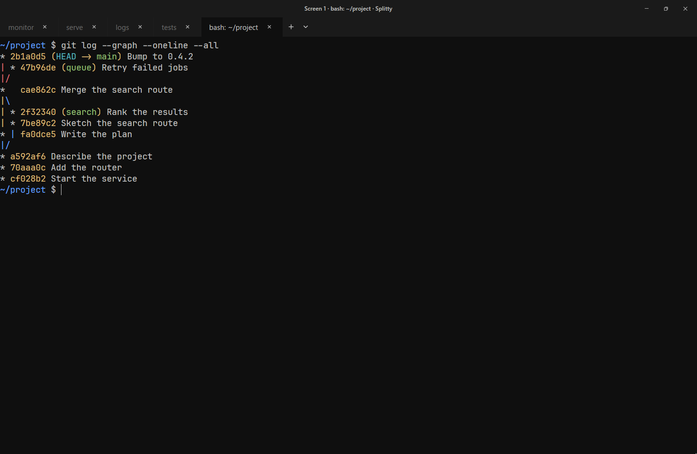
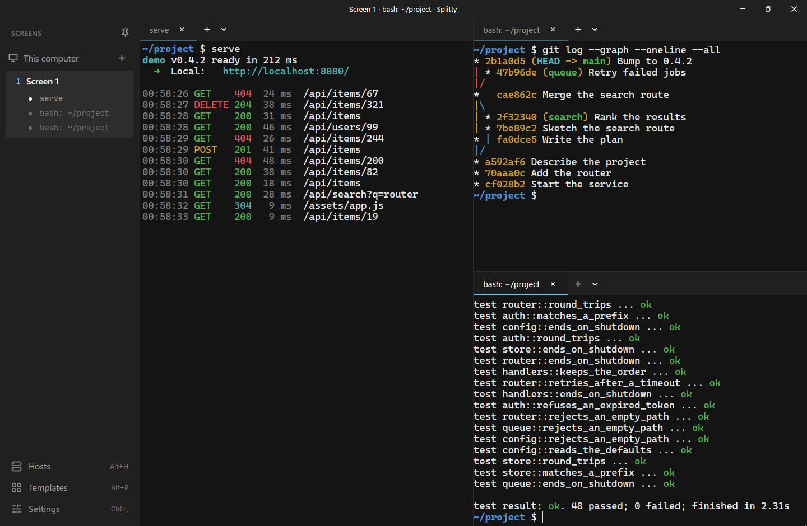

<h1> Splitty</h1>

A graphical terminal multiplexer for Linux, macOS and Windows.

## Install

[Install](docs/install.md) has the commands to copy for each system; the
files are on the
[latest release](https://github.com/npgrosser/splitty/releases/latest) page.

| System | How |
|---|---|
| [Windows 10/11](docs/install.md#windows) (x64, with WSL 2) | Installer |
| [macOS](docs/install.md#macos) (Apple silicon, Intel) | Disk image |
| [Debian, Ubuntu](docs/install.md#debian-ubuntu) (x86_64) | deb |
| [Fedora, openSUSE](docs/install.md#fedora-opensuse) (x86_64) | rpm |
| [Any other Linux](docs/install.md#any-other-linux) (x86_64) | `curl -fsSL https://raw.githubusercontent.com/npgrosser/splitty/main/packaging/linux/native/install.sh \| sh` |
| [NixOS, Nix](docs/install.md#nix) (x86_64) | `nix run github:npgrosser/splitty` |
| [Everything else](docs/install.md#not-supported) | Not supported |

> A personal project in active development (0.x), used daily on all three
> systems. Expect rough edges and changes between versions.

## Full control with the keyboard or the mouse

Splits and tabs are opened, moved, resized and closed entirely with keys:

Or entirely with the mouse:

Every key can be changed: [Keyboard](docs/keyboard.md).

## Multiple screens on local and remote machines

Splitty connects with your `ssh` and installs itself on the host. Remote
sessions keep running when you disconnect or close the app, without tmux or
screen: [Remote development](docs/remote.md).

Ports that programs open on the host are detected and forwarded with a click:

## Customize themes and keys

[Themes](docs/themes.md) · [Keyboard](docs/keyboard.md)

## More

| | |
|---|---|
| [Guide](docs/guide.md) | First steps, templates, how it works |
| [Install](docs/install.md) | Packages, the `splitty` command, building from source |
| [Remote development](docs/remote.md) | Remote screens, ports, host requirements |
| [Files and editors](docs/files-and-editors.md) | Uploads, screenshots, `splitty download`, `splitty open`, editors |
| [The `splitty` command](docs/cli.md) · [Managed jobs](docs/cli-jobs.md) | `attach`, `daemon`, in-pane commands, `splitty run` |
| [Keyboard](docs/keyboard.md) · [Themes](docs/themes.md) | Every command and its keys; themes and palettes |
| [Security](SECURITY.md) | Threat model and guarantees |
| [Known issues](docs/known-issues.md) | Platform quirks, with workarounds |
| [Architecture](docs/architecture.md) · [Networking](docs/networking.md) · [Development](docs/development.md) | How it is built |

Written in Rust; terminal emulation by [libghostty](https://ghostty.org).
Bugs and ideas are welcome as
[GitHub issues](https://github.com/npgrosser/splitty/issues). MIT, see
[LICENSE](LICENSE).
