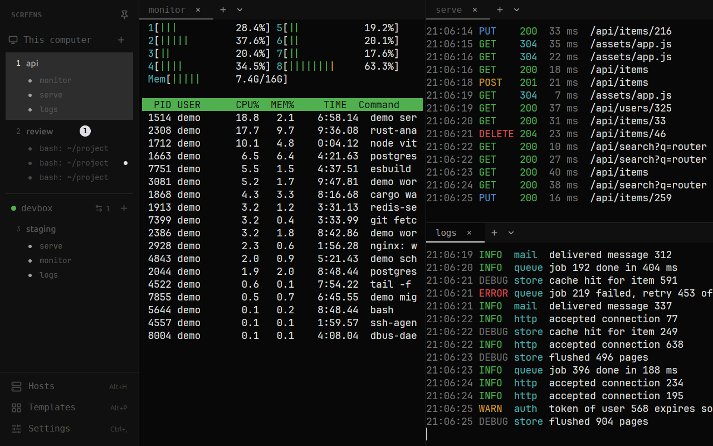
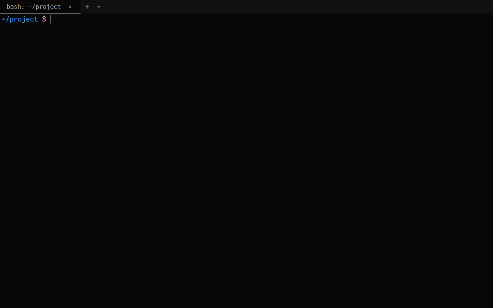
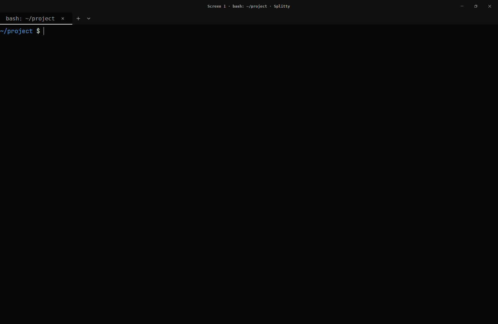
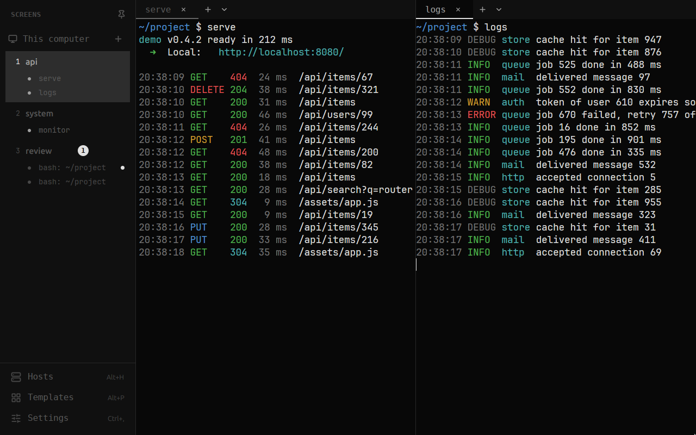
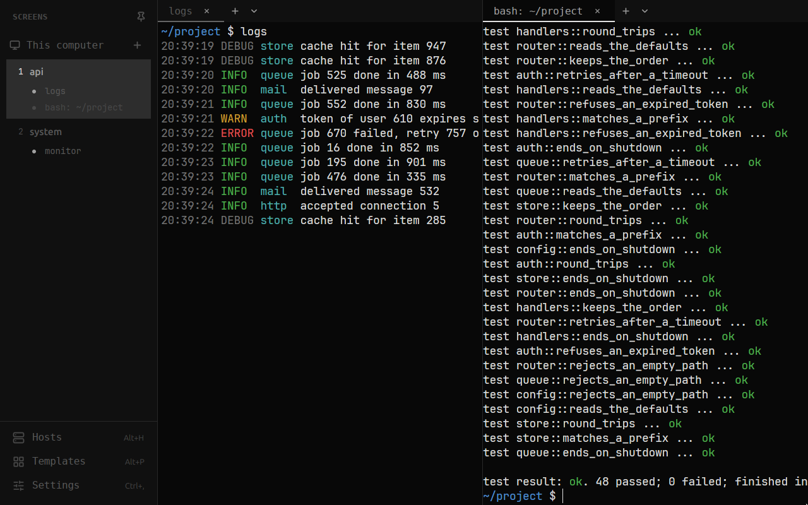
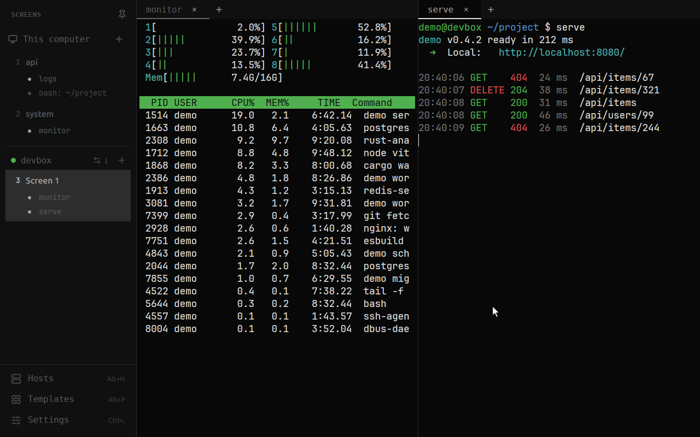
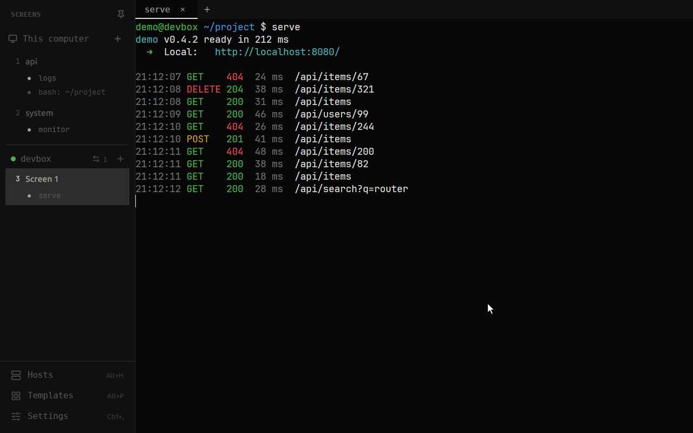

# Splitty

A graphical terminal multiplexer for Linux, macOS and Windows.

## Install

Download the package for your system from the
[latest release](https://github.com/npgrosser/splitty/releases/latest):
Windows 10/11 (with WSL 2), macOS (Apple silicon and Intel) and Linux (deb,
rpm, tar.gz). The notes for each system are in [Install](docs/install.md).

> A personal project in active development (0.x), used daily on all three
> systems. Expect rough edges and changes between versions.

## A terminal

A native app written in Rust and drawn on the GPU, without a browser engine.
Terminal emulation is [libghostty-vt](https://ghostty.org), Ghostty's library.

## Splits and tabs from the keyboard

Every key can be changed: [Keyboard](docs/keyboard.md).

## Drag tabs into a layout

## A screen per task

## Remote hosts beside your local screens

Splitty connects with your `ssh` and installs itself on the host:
[Remote development](docs/remote.md).

## Disconnect, and the host keeps working

## Forward a remote port with a click

A remote terminal's folder also opens in VS Code or Zed on your computer:
[Files and editors](docs/files-and-editors.md).

## See which agent needs you

A program reports its status with an escape sequence; each terminal has a
scratchpad for the next prompt. To let a coding agent open tabs and splits
itself, add to your `CLAUDE.md` or `AGENTS.md`:

> Use Splitty to run commands and launch other agents in tabs and splits;
> first read `splitty agent guide`.

## Themes and keys

[Themes](docs/themes.md) · [Keyboard](docs/keyboard.md)

## More

| | |
|---|---|
| [Guide](docs/guide.md) | First steps, templates, how it works |
| [Install](docs/install.md) | Packages, the `splitty` command, building from source |
| [Remote development](docs/remote.md) | Remote screens, ports, host requirements |
| [Files and editors](docs/files-and-editors.md) | Uploads, screenshots, `splitty download`, `splitty open`, editors |
| [The `splitty` command](docs/cli.md) · [Managed jobs](docs/cli-jobs.md) | `attach`, `daemon`, in-pane commands, `splitty run` |
| [Keyboard](docs/keyboard.md) · [Themes](docs/themes.md) | Every command and its keys; themes and palettes |
| [Security](SECURITY.md) | Threat model and guarantees |
| [Known issues](docs/known-issues.md) | Platform quirks, with workarounds |
| [Architecture](docs/architecture.md) · [Networking](docs/networking.md) · [Development](docs/development.md) | How it is built |

Bugs and ideas are welcome as
[GitHub issues](https://github.com/npgrosser/splitty/issues). MIT, see
[LICENSE](LICENSE).
