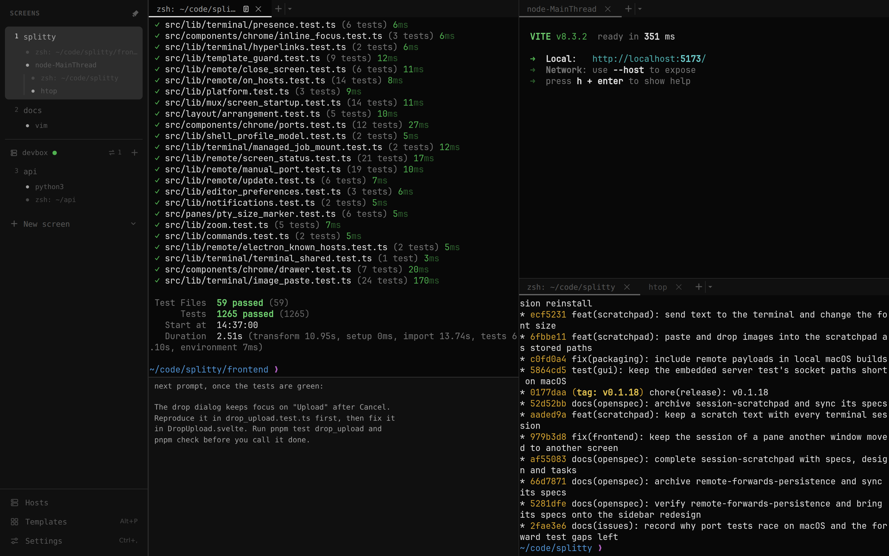
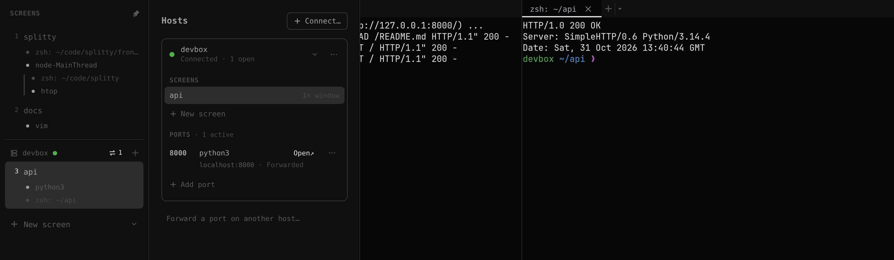

# Splitty

A graphical terminal multiplexer for Linux, macOS and Windows.



## The idea

Splitty brings terminals from your own machine and multiple SSH hosts into
one window. Organize them in splits, tabs and named screens. Remote sessions
keep running when you close the app or lose the connection, so you can
reconnect and continue where you left off.

Working with coding agents helped shape Splitty: keeping track of many
Claude Code or Codex sessions running in parallel, sometimes across several
projects, with dev servers and tests alongside them, locally or on remote VMs.

> **Status:** a personal project in active development (0.1.x), used daily on
> all three systems. Expect rough edges and changes between versions.

## Contents

- [Features](#features)
- [Install](#install)
- [Getting started](#getting-started)
- [Advanced: the `splitty` command](#advanced-the-splitty-command)
- [How it works](#how-it-works)
- [Keyboard shortcuts](#keyboard-shortcuts)
- [Configuration](#configuration)
- [Security](#security)
- [Limitations](#limitations)
- [Documentation](#documentation)
- [Building from source](#building-from-source)

## Features

### Screens, splits and tabs

Arrange terminals in splits and tabs with drag and drop or shortcuts, and keep
separate layouts on named screens. The drawer lists every screen, local and
remote, with what runs in it.

### Remote hosts



- **Remote screens.** Pick a host from your `~/.ssh/config` or type one in,
  and its screens open next to your local ones. Splitty installs itself on the
  host over SSH, so Linux and macOS hosts need no setup.
- **Reconnect where you left off.** Your remote sessions keep running when
  you close your laptop or switch networks. Reconnect and carry on.
- **Ports.** Splitty notices when a program in a remote terminal listens on a
  port, such as a dev server. Forward it with a click; `localhost` links in
  remote terminals then open through the forward.
- **Plain SSH.** Splitty connects with your `ssh` and its configuration, and
  needs no exposed Splitty port on the host.

More in [Remote development](docs/remote.md).

### Files between machines

- **Drop files onto a terminal** to copy them to its machine, local or remote,
  and insert their paths.
- **Paste a screenshot** with Ctrl+V (Cmd+V on macOS). It is stored on the
  terminal's machine, so Claude Code on a remote host can read it.
- **Download a file** from a terminal with `splitty download <file>`; the
  window offers to save it.
- **Open a terminal's folder** in VS Code or Zed on your computer from its
  context menu, remote folders included.

More in [Files and editors](docs/files-and-editors.md).

### For coding agents

- **Let your coding agent use Splitty.** It can start dev servers, run tests
  or launch other agents in tabs and splits alongside your own terminals.
  You can follow along and interact with them directly.
- **Scratchpad.** Each terminal has one (Cmd/Alt+J) for drafting the next
  prompt while the agent works. It stays with the session, and the agent
  can't read it.
- **Viewer panes.** `splitty open PLAN.md` shows a file next to the terminal,
  Markdown and HTML rendered, and follows its changes, so an agent can show
  you its plan or report. A terminal selection opens the same way from the
  context menu. Comment on passages or suggest changes, send the review to
  the agent's terminal as Markdown, and follow the agent's replies in each
  thread; `splitty review` lets an agent wait for your verdict, and as a
  hook of Claude Code it opens each plan for approval
  ([setup](docs/files-and-editors.md#plans-of-claude-code)).

To get started, add this to your `CLAUDE.md` or `AGENTS.md`:

> Use Splitty to run commands and launch other agents in tabs and splits;
> first read `splitty agent guide`.

More in [Managed terminal jobs](docs/cli-jobs.md).

## Install

Download the package for your system from the
[latest release](https://github.com/npgrosser/splitty/releases/latest), or with
the GitHub CLI, for example
`gh release download --repo npgrosser/splitty --pattern 'Splitty_*_aarch64.dmg'`.

| System | File | Notes |
|---|---|---|
| Windows 10/11 (x64) | `Splitty_<version>_x64-setup.exe` | Local terminals run in WSL 2 (Ubuntu or Debian): the app uses the default distribution and installs its backend there. To update, run the newer installer; it replaces an installed earlier version, including the web app of earlier releases. |
| macOS (Apple silicon) | `Splitty_<version>_aarch64.dmg` | Clear the quarantine flag after installing (below). |
| Linux (x86_64) | `splitty_<version>_amd64.deb`, `splitty-<version>-1.x86_64.rpm` or `splitty-<version>-linux-x86_64.tar.gz` | Install the deb (Debian, Ubuntu) or rpm (Fedora, openSUSE) with the system's package manager and start Splitty from the application menu or as `splitty-gpui`. The tar.gz runs from where it is unpacked: `./splitty-gpui`. |

These are the native app. It draws its own interface on the GPU (Vulkan on
Linux, Wayland or X11) and needs no browser engine. The deb and rpm install to
`/opt/splitty` and name the libraries they need; with the tar.gz, keep the
`splitty` command and the `shell-integration/` folder next to `splitty-gpui`.

### The web app

The earlier desktop app, which shows the web interface in a system web view
(Tauri) or in Electron, is no longer released; v0.3.0 was the last release with
its packages. Its code stays in the repository and builds
[from source](#building-from-source). An Intel Mac and Windows without WSL
(where it opens remote hosts only) need it.

```bash
xattr -dr com.apple.quarantine /Applications/Splitty.app
```

Local terminals of the native app and remote terminals have the
[`splitty` command](#advanced-the-splitty-command) for the agent features and
`splitty download`. In the web app on macOS and Linux, local terminals need it
[installed](#installing-the-command).

## Getting started

1. Start the app. It opens one screen with one terminal and the drawer pinned
   beside it. Use the pin button to hide the drawer when not in use; your
   choice is remembered.
2. Split with **Cmd/Alt+D** and **Cmd/Alt+Shift+D**, open a tab with
   **Cmd/Alt+T** and a screen with **Ctrl+Shift+Space**. **Ctrl+B** opens the
   drawer when it is unpinned.
3. For a remote screen, click the arrow next to **New screen** in the drawer
   and choose **On a host…**. Connect to a new host once with plain `ssh`
   first to accept its key.
4. **Cmd/Alt+Shift+P** opens the command palette with everything else, and
   **Ctrl+,** the settings.

Cmd is for macOS, Alt for Linux and Windows; all shortcuts are listed
[below](#keyboard-shortcuts).

In the native local workspace preview, **Templates** (Cmd+P on macOS, Alt+P
elsewhere) opens the saved-template library. Save the current Screen by
reviewing its extracted layout and choosing which commands to retain. Loading
a template lets you create a new Screen or replace the current one. Replacement
ends that Screen's existing terminals, including with **Layout only**; use
**Run displayed commands** only after reviewing the exact command list.

## Advanced: the `splitty` command

Day to day, everything happens in the UI. The `splitty` command adds a few
things on top:

| Command | What it does |
|---|---|
| `splitty attach` | Shows a session in a plain terminal, without the UI |
| `splitty connect user@host` | Opens a host in the browser, without the desktop app |
| `splitty serve` | Serves the UI to a browser on this machine |
| `splitty daemon start` | Starts an independent persistent local backend (macOS, Linux) |
| `splitty open <path>` | From inside a pane: shows a file in a viewer pane next to it; folders and `--editor` go to your editor |
| `splitty run`, `splitty logs` | Managed background processes, mostly for agents |

Everything about the command is in [`docs/cli.md`](docs/cli.md).

### Installing the command

Terminals of the native app, on remote hosts and in the Windows web app have it
already. The web app on macOS and Linux doesn't install it, and neither app
puts it on the `PATH` of other terminals; take it from the archive of the same
release:

```bash
# Linux x86_64; on other systems splitty-wsl-aarch64 or splitty-darwin-<arch>
mkdir -p ~/.local/share/splitty-cli
tar -xzf splitty-wsl-x86_64.tar.gz -C ~/.local/share/splitty-cli
export PATH="$HOME/.local/share/splitty-cli:$PATH"   # add this to your shell profile
```

Keep the `shell-integration/` folder next to the binary. On a Mac, if the
browser downloaded the archive, run
`xattr -dr com.apple.quarantine ~/.local/share/splitty-cli`.

## How it works

| Connection | Transport | Session lifetime |
|---|---|---|
| Desktop, local terminals | Native IPC to an in-process Tauri service on Unix, or owned child pipes for Electron and WSL | End when the app quits |
| Explicit local daemon | Private Unix socket | Independent of the app |
| SSH host | SSH data channel to the host’s private socket | Survive disconnects and app exit |
| Explicit browser access | Loopback HTTP/WebSocket gateway to one selected backend | Follow that backend’s lifetime |

- The server holds the layout and the terminals, so several windows can show
  the same screens and stay in sync.
- The desktop app owns its local backend and closes its local sessions when
  you quit. A separately started daemon runs independently. On an SSH host,
  Splitty runs as a daemon and keeps each session in a small keeper process,
  so sessions survive disconnects and daemon restarts or updates.
- For remote screens, the local server is a hub: it installs and starts
  Splitty on the host and relays it over SSH.
- The server is Rust (Tokio, Axum, portable-pty); the UI is Svelte 5 with
  [dockview](https://github.com/mathuo/dockview) and xterm.js (ghostty-web as
  an option). Released desktop apps use [Tauri v2](https://v2.tauri.app) on
  macOS and Windows, and Electron on Linux. On Windows the server runs in WSL 2
  behind a native WebView2 window.

More in [`docs/architecture.md`](docs/architecture.md).

## Keyboard shortcuts

| Action | macOS | Linux, Windows |
|---|---|---|
| Split right / down | Cmd+D / Cmd+Shift+D | Alt+D / Alt+Shift+D |
| New tab | Cmd+T | Alt+T |
| Close tab | Cmd+W | Alt+W |
| New screen | Ctrl+Shift+Space | Ctrl+Shift+Space |
| Switch to screen 1–9 | Cmd+Shift+1–9 | Alt+Shift+1–9 |
| Next / previous pane | Cmd+Shift+→ / ← | Alt+Shift+→ / ← |
| Focus up / down | Cmd+Shift+↑ / ↓ | Alt+Shift+↑ / ↓ |
| Resize pane | Ctrl+Shift+Arrow | Ctrl+Shift+Arrow |
| Maximize pane | Cmd+M | Alt+M |
| Scratchpad | Cmd+J | Alt+J |
| Open URL or port in the browser | Cmd+O | Alt+O |
| Templates | Cmd+P | Alt+P |
| Command palette | Cmd+Shift+P | Alt+Shift+P |
| Drawer | Ctrl+B | Ctrl+B |
| Settings | Ctrl+, | Ctrl+, |
| Zoom in / out / reset | Cmd+= / Cmd+- / Cmd+0 | Ctrl+= / Ctrl+- / Ctrl+0 |

## Configuration

The settings (Ctrl+,) are saved in `config.toml` in `~/.config/splitty/`
(macOS: `~/Library/Application Support/splitty/`). Custom themes go into a
`themes/` folder next to it.

## Security

Whoever controls Splitty gets a shell with your rights, so it is built to be
reachable only by you. Desktop connections use IPC or pipes; daemons use
private Unix sockets, and remote connections travel over SSH. Only explicit
browser access starts a loopback HTTP/WebSocket gateway, with single-use
sign-in codes, `HttpOnly` cookies and origin checks. Shells in panes never
receive a browser credential. Processes running as your own user are not isolated from
Splitty, as with tmux.

The full model is in [`SECURITY.md`](SECURITY.md). Please report
vulnerabilities privately through
[GitHub security advisories](https://github.com/npgrosser/splitty/security/advisories/new).

## Limitations

- The binaries are not code-signed (see [Install](#install)).
- On Windows, local terminals need WSL 2. Without a supported
  distribution the native app says so and does not start; the web app, built
  from source, opens remote hosts only.
- The native macOS app is built for Apple silicon; Intel Macs need the web app,
  built from source.
- On a Mac host, Splitty doesn't detect listening ports yet; forward them by
  number.
- In the web app, xterm.js can garble IME and dead-key input on macOS
  (see [known issues](docs/known-issues.md)).

## Documentation

| Document | Content |
|---|---|
| [Remote development](docs/remote.md) | Remote screens, ports, remote windows, `splitty connect`, host requirements |
| [Files and editors](docs/files-and-editors.md) | Drop uploads, screenshots, `splitty download`, `splitty open`, VS Code, Zed and SFTP |
| [The `splitty` command](docs/cli.md) | Server modes, `serve`, `daemon`, `attach`, in-pane commands, signing in |
| [Managed terminal jobs](docs/cli-jobs.md) | `splitty run`, logs, agent grants |
| [`SECURITY.md`](SECURITY.md) | Threat model and guarantees |
| [Known issues](docs/known-issues.md) | Upstream bugs and platform quirks, with workarounds |
| [Architecture](docs/architecture.md) | How the server, protocol and UI fit together |
| [Connections and networking](docs/networking.md) | Visual guides to IPC, SSH, browser gateways, listeners and session lifetime |
| [Development](docs/development.md) | Building, packaging and releasing |
| [Native UI checkpoint](docs/native-ui-handoff.md) | Experimental GPUI branch, verified preview, remaining work and continuation on another machine |
| [Roadmap](roadmap/README.md) | Milestones and what comes next (German) |

## Building from source

You need Rust (stable) and Node.js 24 with pnpm. The native app also needs
Python 3 and a C toolchain for its terminal library and, on Linux, the
development packages listed in [Development](docs/development.md#the-native-app).
The web app's Tauri builds need the
[Tauri v2 prerequisites](https://v2.tauri.app/start/prerequisites/).

```bash
make dev                  # server with the embedded UI on 127.0.0.1:9800, rebuilt on changes
make native-package       # native app: deb, rpm and tar.gz (Linux) or dmg (macOS) in build/
make install-no-gui       # only splitty, to ~/.local/bin

make install-electron     # web app on Linux → ~/.local/bin/Splitty-Electron.AppImage
make dev-tauri            # web app in Tauri with rebuilds, native IPC
make install-tauri        # web app in Tauri; on Linux also splitty in ~/.local/bin
```

Running the native app from a checkout, the Windows installers, the web apps'
packages and releases are described in [Development](docs/development.md). A
build of your own installs itself on remote hosts only with a payload: set
`SPLITTY_REMOTE_PAYLOAD` as
[Remote development](docs/remote.md#installing-splitty-on-hosts) explains, or
put `splitty` on the host's `PATH`.

## Feedback

Bugs, rough edges and ideas are welcome as
[GitHub issues](https://github.com/npgrosser/splitty/issues).

## License

MIT, see [LICENSE](LICENSE).
