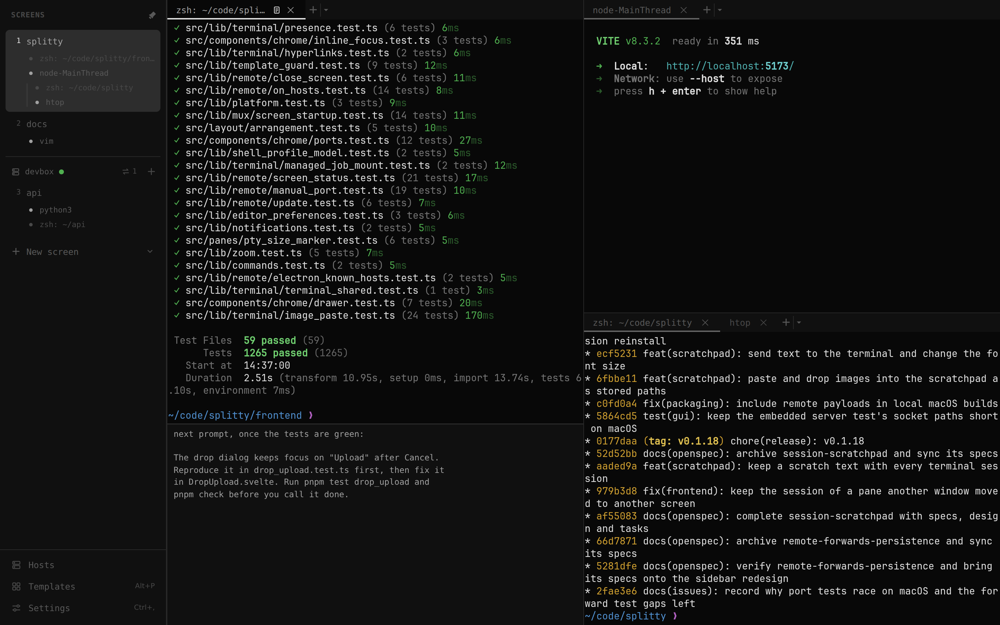
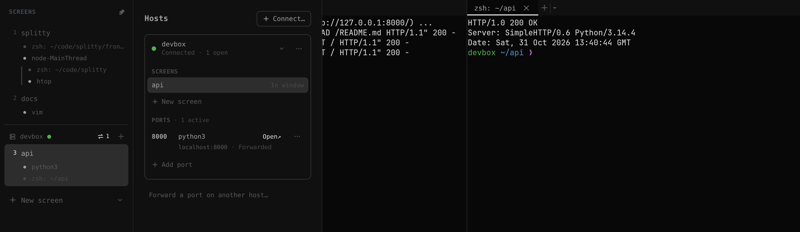

# Splitty

A graphical terminal multiplexer for Linux, macOS and Windows.



## The idea

Splitty brings terminals from your own machine and multiple SSH hosts into
one window. Organize them in splits, tabs and named screens. Remote sessions
keep running when you close the app or lose the connection, so you can
reconnect and continue where you left off.

Working with coding agents helped shape Splitty: keeping track of many
Claude Code or Codex sessions running in parallel, sometimes across several
projects, with dev servers and tests alongside them, locally or on remote VMs.

> **Status:** a personal project in active development (0.1.x), used daily on
> all three systems. Expect rough edges and changes between versions.

## Contents

- [Features](#features)
- [Install](#install)
- [Getting started](#getting-started)
- [Advanced: the `splitty` command](#advanced-the-splitty-command)
- [How it works](#how-it-works)
- [Keyboard shortcuts](#keyboard-shortcuts)
- [Configuration](#configuration)
- [Security](#security)
- [Limitations](#limitations)
- [Documentation](#documentation)
- [Building from source](#building-from-source)

## Features

### Screens, splits and tabs

Arrange terminals in splits and tabs with drag and drop or shortcuts, and keep
separate layouts on named screens. The drawer lists every screen, local and
remote, with what runs in it.

### Remote hosts



- **Remote screens.** Pick a host from your `~/.ssh/config` or type one in,
  and its screens open next to your local ones. Splitty installs itself on the
  host over SSH, so Linux and macOS hosts need no setup.
- **Reconnect where you left off.** After a closed laptop or a network change,
  the window reconnects, with everything printed in the meantime.
- **Ports.** Splitty notices when a program in a remote terminal listens on a
  port, such as a dev server. Forward it with a click; `localhost` links in
  remote terminals then open through the forward.
- **Plain SSH.** Splitty connects with your `ssh` and its configuration, and
  never listens on the network.

More in [Remote development](docs/remote.md).

### Files between machines

- **Drop files onto a terminal** to copy them to its machine, local or remote,
  and insert their paths.
- **Paste a screenshot** with Ctrl+V (Cmd+V on macOS). It is stored on the
  terminal's machine, so Claude Code on a remote host can read it.
- **Download a file** from a terminal with `splitty download <file>`; the
  window offers to save it.
- **Open a terminal's folder** in VS Code or Zed on your computer from its
  context menu, remote folders included.

More in [Files and editors](docs/files-and-editors.md).

### For coding agents

- **Scratchpad.** Each terminal has one (Cmd/Alt+J) for drafting the next
  prompt while the agent works. It stays with the session, and the agent
  can't read it.
- **Visible background processes.** With `splitty run`, an agent starts a dev
  server or a watcher in a tab of its own. You both see the output, and the
  process outlives the agent.
- **Setup** is one line in `CLAUDE.md` or `AGENTS.md`: *Use Splitty for
  visible terminals and background processes; first read
  `splitty agent guide`.*

More in [Managed terminal jobs](docs/cli-jobs.md).

## Install

Download the package for your system from the
[latest release](https://github.com/npgrosser/splitty/releases/latest), or with
the GitHub CLI, for example
`gh release download --repo npgrosser/splitty --pattern '*.dmg'`.

| System | File | Notes |
|---|---|---|
| Windows 10/11 (x64) | `Splitty_<version>_x64-setup.exe` | Local terminals run in WSL 2 (Ubuntu or Debian); the app's setup page shows how to get it. Without WSL, the app opens remote hosts only. To update, run the newer installer. |
| macOS (Apple silicon and Intel) | `Splitty_<version>_universal.dmg` | Clear the quarantine flag after installing (below). |
| Linux (x86_64) | `Splitty_<version>_amd64.deb` or `Splitty_<version>_amd64.AppImage` | If WebKitGTK gives you trouble: `Splitty-Electron-<version>-x86_64.AppImage`. |

The binaries are not code-signed, so Windows SmartScreen and macOS Gatekeeper
warn about them, and Smart App Control, where it is on, blocks them. Check the
download against `SHA256SUMS` from the release:

```bash
sha256sum -c SHA256SUMS --ignore-missing     # macOS: shasum -a 256 <file>
```

On macOS, then clear the quarantine flag:

```bash
xattr -dr com.apple.quarantine /Applications/Splitty.app
```

On macOS and Linux, local terminals need the
[`splitty` command](#installing-the-command) for the agent features and
`splitty download`; remote terminals have it already.

## Getting started

1. Start the app. It opens one screen with one terminal.
2. Split with **Cmd/Alt+D** and **Cmd/Alt+Shift+D**, open a tab with
   **Cmd/Alt+T** and a screen with **Ctrl+Shift+Space**. **Ctrl+B** shows the
   drawer.
3. For a remote screen, click the arrow next to **New screen** in the drawer
   and choose **On a host…**. Connect to a new host once with plain `ssh`
   first to accept its key.
4. **Cmd/Alt+Shift+P** opens the command palette with everything else, and
   **Ctrl+,** the settings.

Cmd is for macOS, Alt for Linux and Windows; all shortcuts are listed
[below](#keyboard-shortcuts).

## Advanced: the `splitty` command

Day to day, everything happens in the UI. The `splitty` command adds a few
things on top:

| Command | What it does |
|---|---|
| `splitty attach` | Shows a session in a plain terminal, without the UI |
| `splitty connect user@host` | Opens a host in the browser, without the desktop app |
| `splitty serve` | Serves the UI to a browser on this machine |
| `splitty daemon start` | Keeps local sessions running while the app is closed (macOS, Linux) |
| `splitty open <path>` | From inside a pane: opens a file in your editor |
| `splitty run`, `splitty logs` | Managed background processes, mostly for agents |

Everything about the command is in [`docs/cli.md`](docs/cli.md).

### Installing the command

Terminals on remote hosts and in the Windows app have it already. The desktop
app on macOS and Linux doesn't install it; take it from the archive of the same
release:

```bash
# Linux x86_64; on other systems splitty-wsl-aarch64 or splitty-darwin-<arch>
mkdir -p ~/.local/share/splitty-cli
tar -xzf splitty-wsl-x86_64.tar.gz -C ~/.local/share/splitty-cli
export PATH="$HOME/.local/share/splitty-cli:$PATH"   # add this to your shell profile
```

Keep the `shell-integration/` folder next to the binary. On a Mac, if the
browser downloaded the archive, run
`xattr -dr com.apple.quarantine ~/.local/share/splitty-cli`.

## How it works

```
  clients                      local server                         remote host
 ┌────────────────┐  HTTP+WS  ┌────────────────────────┐   SSH    ┌──────────────────────┐
 │ desktop app    │──────────▶│ splitty                │─────────▶│ splitty daemon       │
 │ browser tab    │ 127.0.0.1 │ embedded or daemon     │  relay   │ on its own loopback  │
 │ splitty attach │           │ layout, sessions, jobs │          │ layout, sessions     │
 └────────────────┘           └───┬─────────────▲──────┘          └───┬──────────────────┘
                                  │ PTYs        │ Unix socket         │ PTYs
                                  ▼             │                     ▼
                           shells, agents ── splitty CLI        shells, agents
```

- The server holds the layout and the terminals, so several windows can show
  the same screens and stay in sync.
- The desktop app runs its own server, which ends with the app; on macOS and
  Linux it uses a running `splitty daemon` instead. On a host, Splitty always
  runs as a daemon and keeps each session in a small keeper process, so
  sessions survive a restart or update of the daemon.
- For remote screens, the local server is a hub: it installs and starts
  Splitty on the host and relays it over SSH.
- The server is Rust (Tokio, Axum, portable-pty); the UI is Svelte 5 with
  [dockview](https://github.com/mathuo/dockview) and xterm.js (ghostty-web as
  an option). The desktop app uses [Tauri v2](https://v2.tauri.app), with an
  Electron build for Linux; on Windows the server runs in WSL 2 behind a native
  WebView2 window.

More in [`docs/architecture.md`](docs/architecture.md).

## Keyboard shortcuts

| Action | macOS | Linux, Windows |
|---|---|---|
| Split right / down | Cmd+D / Cmd+Shift+D | Alt+D / Alt+Shift+D |
| New tab | Cmd+T | Alt+T |
| Close tab | Cmd+W | Alt+W |
| New screen | Ctrl+Shift+Space | Ctrl+Shift+Space |
| Switch to screen 1–9 | Cmd+Shift+1–9 | Alt+Shift+1–9 |
| Next / previous pane | Cmd+Shift+→ / ← | Alt+Shift+→ / ← |
| Focus up / down | Cmd+Shift+↑ / ↓ | Alt+Shift+↑ / ↓ |
| Resize pane | Ctrl+Shift+Arrow | Ctrl+Shift+Arrow |
| Maximize pane | Cmd+M | Alt+M |
| Scratchpad | Cmd+J | Alt+J |
| Open URL or port in the browser | Cmd+O | Alt+O |
| Templates | Cmd+P | Alt+P |
| Command palette | Cmd+Shift+P | Alt+Shift+P |
| Drawer | Ctrl+B | Ctrl+B |
| Settings | Ctrl+, | Ctrl+, |
| Zoom in / out / reset | Cmd+= / Cmd+- / Cmd+0 | Ctrl+= / Ctrl+- / Ctrl+0 |

## Configuration

The settings (Ctrl+,) are saved in `config.toml` in `~/.config/splitty/`
(macOS: `~/Library/Application Support/splitty/`). Custom themes go into a
`themes/` folder next to it.

## Security

Whoever controls Splitty gets a shell with your rights, so it is built to be
reachable only by you. The server listens only on loopback, and other machines
are reached over SSH. The UI signs in with single-use codes and `HttpOnly`
cookies, requests from other origins are refused, and shells in panes never
receive a credential. Processes running as your own user are not isolated from
Splitty, as with tmux.

The full model is in [`SECURITY.md`](SECURITY.md). Please report
vulnerabilities privately through
[GitHub security advisories](https://github.com/npgrosser/splitty/security/advisories/new).

## Limitations

- The binaries are not code-signed (see [Install](#install)).
- On Windows, local terminals need WSL 2; without it, the app opens remote
  hosts only.
- On a Mac host, Splitty doesn't detect listening ports yet; forward them by
  number.
- xterm.js can garble IME and dead-key input on macOS
  (see [known issues](docs/known-issues.md)).

## Documentation

| Document | Content |
|---|---|
| [Remote development](docs/remote.md) | Remote screens, ports, remote windows, `splitty connect`, host requirements |
| [Files and editors](docs/files-and-editors.md) | Drop uploads, screenshots, `splitty download`, `splitty open`, VS Code, Zed and SFTP |
| [The `splitty` command](docs/cli.md) | Server modes, `serve`, `daemon`, `attach`, in-pane commands, signing in |
| [Managed terminal jobs](docs/cli-jobs.md) | `splitty run`, logs, agent grants |
| [`SECURITY.md`](SECURITY.md) | Threat model and guarantees |
| [Known issues](docs/known-issues.md) | Upstream bugs and platform quirks, with workarounds |
| [Architecture](docs/architecture.md) | How the server, protocol and UI fit together |
| [Development](docs/development.md) | Building, packaging and releasing |
| [Roadmap](roadmap/README.md) | Milestones and what comes next (German) |

## Building from source

You need Rust (stable), Node.js 24 with pnpm, and for the desktop app the
[Tauri v2 prerequisites](https://v2.tauri.app/start/prerequisites/).

```bash
make dev                  # server with the embedded UI on 127.0.0.1:9800, rebuilt on changes
make install-tauri        # desktop app; on Linux also splitty in ~/.local/bin
make install-no-gui       # only splitty, to ~/.local/bin
```

The macOS app, the Windows installer, the Electron AppImage and releases are
described in [Development](docs/development.md). A build of your own installs
itself on remote hosts only with a payload: set `SPLITTY_REMOTE_PAYLOAD` as
[Remote development](docs/remote.md#installing-splitty-on-hosts) explains, or
put `splitty` on the host's `PATH`.

## Feedback

Bugs, rough edges and ideas are welcome as
[GitHub issues](https://github.com/npgrosser/splitty/issues).

## License

MIT, see [LICENSE](LICENSE).
