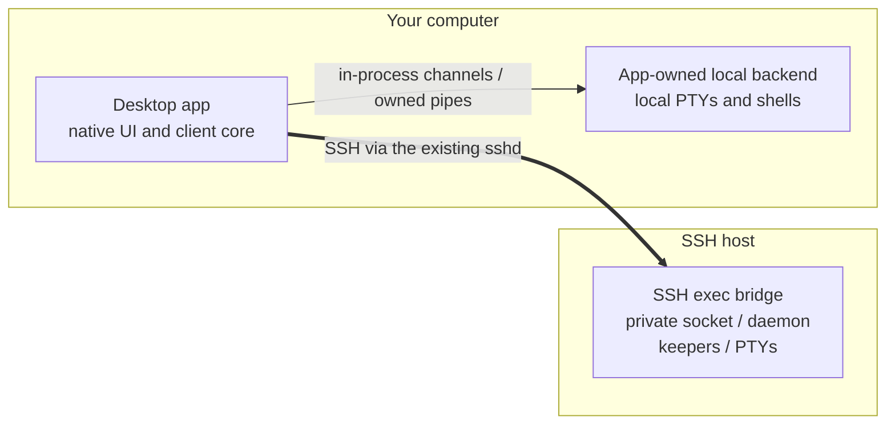
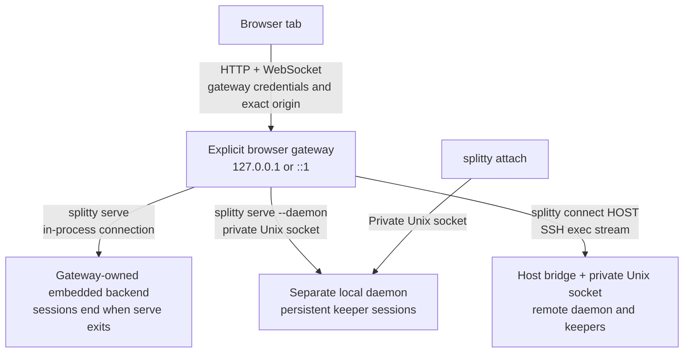
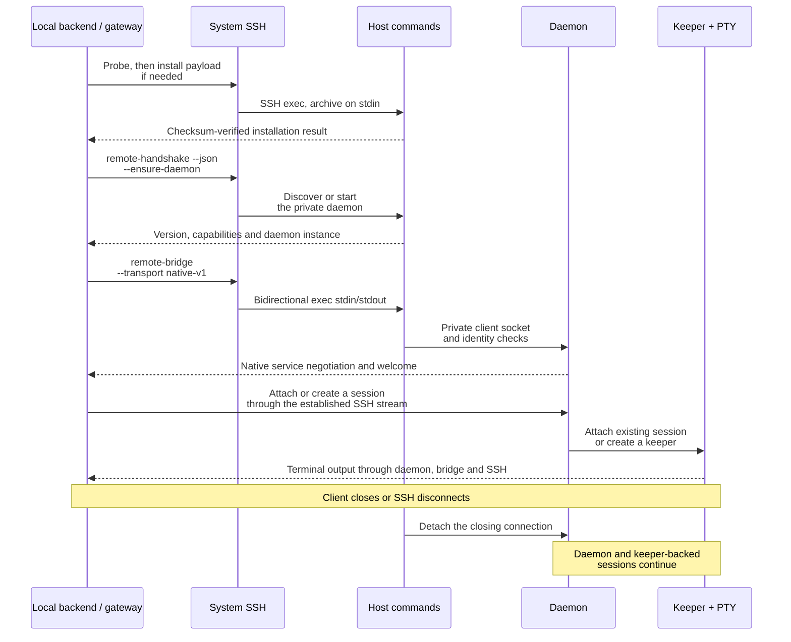

# Connections, listeners and session lifetime

The app owns its local terminal backend. Remote terminals belong to a
daemon on the SSH host. A browser uses an explicitly started local gateway.
These choices determine both the transport and what happens when a client closes.

The diagrams below show runtime connections. The [LikeC4 model](../architecture/README.md)
maps the code that implements them: its containers are crates and its component
arrows are dependencies, not necessarily process or network boundaries.

## At a glance

The thick edge crosses machines; the thin edge stays local. For remote screens,
the local backend's hub owns the SSH connection. The detailed host-side hops appear in
the sequence diagram below. The SSH service is the host's existing `sshd`; Splitty
starts no terminal-service TCP listener on that host. SSH configuration may route through
a jump host or `ProxyCommand`; the destination and authentication are those of
the selected system SSH client.

| Use | UI / client to backend | TCP listener for Splitty UI | Session lifetime |
| --- | --- | --- | --- |
| Desktop, local | In-process channels, or the pipes of an app-owned child process | None | Local sessions end when the app exits |
| Separate local daemon | Private Unix client socket, for example with `splitty attach` | None | Keeper-backed sessions outlive clients and ordinary daemon restarts |
| Desktop, SSH host | The local backend's hub: native stream over SSH exec stdin/stdout, then the host's private client socket | None; uses the existing SSH service | Host sessions survive client exit and connection loss |
| Explicit browser access | HTTP/WebSocket to a loopback gateway, then its selected backend | One explicitly requested loopback gateway | Determined by the selected backend, not the browser tab |

Closing a pane deliberately can end its session. Closing a remote view or losing
its connection only detaches it. Keeper persistence does not survive a host
shutdown, and `daemon stop --end-sessions` deliberately ends kept sessions.

## The local desktop backend

The app always starts its own backend, even if a separate local daemon is
already running. It neither attaches to that daemon nor adopts its old keepers.

| Platform | Local backend location | Connection |
| --- | --- | --- |
| Linux, macOS | Embedded in the app's process | In-process byte channels |
| Windows | An application-owned Linux helper in the selected WSL 2 distribution (`desktop-backend --owner`) | The owned `wsl.exe` stdin/stdout pipes |

The app assigns each window its backend. Remote screens reach their hosts only through the local backend's hub,
so on Windows they use WSL's `ssh`. The UI is part of the app's executable; a
remote host supplies terminal data and service responses, never UI code.

The Tauri shell built from source keeps the same backend placement behind a
WebView: its pages reach the native process over IPC, and the native process
assigns each page its backend and permissions. Its separate remote windows
hold their own SSH connection, with authority only for their assigned host,
and on Windows use Windows OpenSSH without WSL
([development](development.md#the-tauri-shell)).

## Explicit browser access and separate daemons

The three gateway branches are alternatives selected at startup. Each gateway
owns its browser credentials and serves UI assets locally. It is bound to one
selected backend; the browser cannot substitute a private socket path or an
upstream HTTP address for that assignment. Opening
a browser gateway does not change a daemon's lifetime. Closing the last browser
tab does not, by itself, stop the gateway or its selected backend.

The gateway reaches its backend only as a native client: each `/api` route is an
operation of the native catalog, `/ws` a native client connection and
`/ws/remote`, where the backend may open hosts, a native host stream of its hub.
The server has no second HTTP API or WebSocket relay for browsers.

`splitty daemon start` opens private Unix endpoints, not HTTP. `splitty serve`
creates an embedded workspace with its own lifetime; `splitty serve --daemon`
explicitly selects the independent daemon. `splitty connect HOST` exposes only
the local browser gateway: it does not forward a remote Splitty HTTP port.

The native client socket is distinct from the narrower owner-control, restricted
agent and keeper sockets. They are local surfaces with different operation sets,
not interchangeable UI transports. Their permissions do not isolate hostile
processes already running as the same OS user.

## An SSH connection, from setup to disconnect

The diagram groups the system SSH calls: probe, installation, discovery and the
long-lived bridge are separate exec operations, not application messages on an
already admitted terminal stream. No browser token travels over these calls.
Both sides verify the native transport and expected service instance before
application input is accepted. An incompatible legacy daemon may require an
explicit, verified update confirmation; retries do not replay an ambiguous
migration or an already admitted mutation.

Preparing a host terminal connection has a fixed ten-minute ceiling. Uploading the archive is
limited to eight minutes and fails after sixty seconds without a successful
write to the owned SSH stdin pipe. After stdin finishes, the command has up to
two minutes to complete. Progress messages do not extend these limits. Each
framing/service handshake still has its separate five-second deadline.
Cancellation closes and reaps owned helpers while retaining their capacity
until exit is observed; it does not stop the remote daemon or its keepers.

## Authentication at each boundary

| Boundary | What authorizes it |
| --- | --- |
| App window to local backend | The app's own in-process channel or owned child pipes; the Tauri shell adds a native-assigned document proof, role and backend for its pages |
| Client to host's SSH service | System OpenSSH host-key verification and the selected user's keys/agent/configuration |
| Host bridge to daemon | Private directory/socket permissions, OS peer UID and verified daemon instance |
| Browser to explicit gateway | Gateway-local bootstrap/session credentials, exact Host/Origin and WebSocket admission checks |
| Daemon to keeper | Private keeper endpoint and its ownership/protocol checks |

SSH authenticates the remote OS login. It does not make every path under that
account's home safe to use as a native endpoint. Splitty additionally verifies
the private directories and peers. Owned group-writable ancestors such as
`~/.local` with `0775` are supported for native endpoints without changing the
parents' modes; the final endpoint directory remains `0700`, its socket `0600`.

## Deliberate development-port forwarding

Forwarding an application port is a separate, opt-in feature. A forward makes a
host service reachable on a local loopback TCP port. A reverse share makes a
local service reachable through the host's loopback relay. These use their own
owned SSH forwarding workers; normal terminal traffic uses exec pipes instead.
See [forwarding and sharing](remote.md#ports) for the user flows.

Browser gateways and reverse shares coordinate through one durable per-user
exposure registry so a share cannot expose a Splitty gateway, including one from
another configuration directory. A reservation exists before the forwarding
worker starts and remains until local worker termination is proved. An unknown
process state or damaged registry blocks admission; it is not treated as empty.

This registry deliberately has stricter path requirements than a native client
socket. Non-sticky group/world-writable ancestors are refused, so an existing
`0775` account-home `.local` or `.local/state` blocks browser gateways and reverse
sharing on native Linux. Pinning one process's directory descriptor cannot
prove that another process sees the same registry after an ancestor is renamed.
Splitty neither changes those parent permissions nor falls back to an
unregistered browser listener. The app's and daemon connections do not
need this registry. See the [registry requirements](remote.md#forwarding-registry-requirements)
for paths and platform restrictions.

## Where the code lives

Run `pnpm --dir architecture dev` from the repository root and select a view:

| LikeC4 view | What to inspect |
| --- | --- |
| `connections` — Connection components | Native, browser and SSH boundaries across the existing modules |
| `gpui` — splitty-gpui components | The app's windows, workspace view, terminal engine and startup |
| `client_core` — splitty-client-core components | The app's UI-free sources, connections and app-owned backends |
| `desktop` — Desktop app components | The Tauri shell: document authority, app-owned backends, WSL and remote windows |
| `remote` — splitty-remote components | SSH invocation, payload installation, bridge, owner and supervision |
| `server` — splitty-server components | Native endpoint, browser gateway, shared operations and client sessions |
| `transport` — splitty-transport components | Framing, negotiation, cancellation and bounded delivery |

The view definitions are in [architecture/views.c4](../architecture/views.c4).
The detailed runtime and ownership rules are in [architecture.md](architecture.md),
the threat boundary in [SECURITY.md](../SECURITY.md), and the public contracts in
[client-connections](../openspec/specs/client-connections/spec.md) and
[access-control](../openspec/specs/access-control/spec.md).
